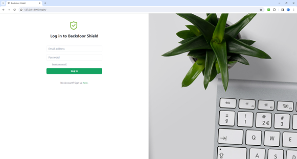
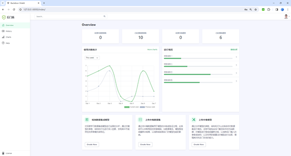
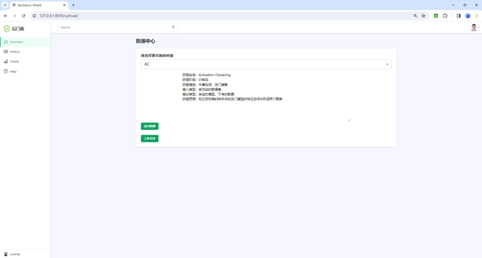
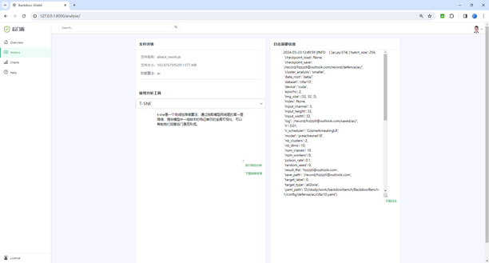
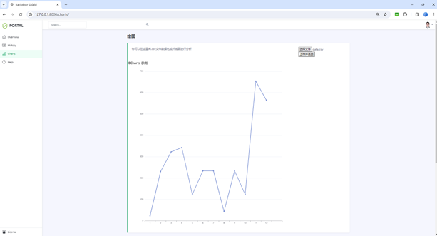

# BackdoorBench-Web · 后门攻防评测平台

将深度学习后门攻防基准 [BackdoorBench](https://github.com/SCLBD/BackdoorBench) 从命令行搬进浏览器的 Web 实验平台：
上传模型 → 在线执行防御算法 → 查看日志 → 生成可视化分析 → 打包下载结果。

> **个人工作**：Web 平台层设计与实现（Django + SQLite）、攻防流程编排、可视化模块集成、工程化修复（路径解耦、异常降级、安全配置）。
> **算法内核**：10 种攻击 / 12 种防御实现来自 BackdoorBench，本项目在其之上构建 Web 层，详见文末「归属与许可」。

## 我的工作

- **网站开发**：独立的 Django 工程（路由 / 视图 / 模板 / 会话鉴权 / 文件上传 / 分页列表），22 个页面与后台管理模板的嵌入改造
- **防御机制接入**：在基准 9 种防御之外，新增 **CLP、I-BAU、MCR** 三种防御的实现与 Web 端接入（下拉选项、算法说明、配置、执行编排）
- **大模型能力**：集成 DeepSeek Chat 作为平台内置助手（`/assistant/` 后端代理 + 右下角对话气泡），提供防御方法推荐与中毒特征解释



---

## 功能

| 模块 | 说明 |
|---|---|
| 账号体系 | 注册 / 登录 / 重置密码，实验数据按账号隔离存放 |
| 模型上传 | 上传 `.pt` 模型文件，保存至 `record/<邮箱>/` |
| 防御执行 | 在线选择防御算法，子进程调用对应脚本 |
| 结果查看 | 读取最新日志并在页面回显 |
| 可视化分析 | t-SNE、神经元激活、Shapley 值、Grad-CAM、频域显著性 |
| 结果下载 | 实验产物 / 日志打包为 zip 下载 |
| AI 助手 | 右下角对话气泡，接入 DeepSeek Chat，解答防御选型与指标含义 |
| 实验列表 | 分页展示实验记录（演示数据） |

<table>
  <tr>
    <td></td>
    <td></td>
  </tr>
  <tr>
    <td></td>
    <td></td>
  </tr>
</table>

---

## 技术栈

- **后端**：Python 3.10 · Django 4.2 · SQLite
- **算法**：PyTorch · torchvision · scikit-learn · SHAP · Grad-CAM
- **前端**：Django 模板 · Bootstrap 5 · FontAwesome · 原生 JS

---

## 快速开始

```bash
# 1. 安装依赖
pip install -r requirements.txt

# 2. 初始化数据库
cd BackdoorBench1/djangoproject
python manage.py migrate

# 3. 启动
python manage.py runserver 127.0.0.1:8001
```

打开 <http://127.0.0.1:8001/login/>，先注册账号再登录。

### 环境变量（可选）

| 变量 | 默认值 | 说明 |
|---|---|---|
| `DJANGO_SECRET_KEY` | 内置开发密钥 | 生产环境务必覆盖 |
| `DJANGO_DEBUG` | `1` | `0` 关闭调试 |
| `DJANGO_ALLOWED_HOSTS` | `127.0.0.1,localhost` | 逗号分隔 |
| `DEEPSEEK_API_KEY` | 空 | AI 助手密钥；未配置时助手返回 503，其它功能不受影响 |
| `DEEPSEEK_MODEL` | `deepseek-chat` | 可选 |

### AI 助手

`POST /assistant/` 接收 `{"message": "..."}`，服务端以流式关闭的方式调用
`https://api.deepseek.com/chat/completions`，返回 `{"reply": "..."}`。

- 前端：`index.html` 右下角气泡，使用 `fetch` + `X-CSRFToken` 调用
- 后端：`views.assistant`，仅依赖标准库 `urllib`，无需额外安装 SDK
- 未配置密钥 / 上游报错时分别返回 `503` / `502`，并给出可读错误信息

### 运行防御 / 可视化（可选）

Web 层不依赖重型依赖即可启动；真正执行算法还需要：

```bash
pip install torch torchvision shap grad-cam scikit-learn pandas opencv-python seaborn tqdm pyyaml
```

并把数据集放到 `BackdoorBench1/data/`（CIFAR-10/100、GTSRB、TinyImageNet，见 `BackdoorBench1/sh/` 下的下载脚本）。
未安装依赖或缺少数据时，**页面不会崩溃**，执行接口会记录失败并跳转到分析页（已做异常降级）。

---

## 目录结构

```
backdoor-shield/
├─ BackdoorBench1/
│  ├─ attack/                 # 10 种后门攻击
│  ├─ defense/                # 12 种后门防御
│  ├─ config/                 # 98 个 YAML 配置（attack/defense/visualization）
│  ├─ visualization/          # 5 种分析脚本
│  ├─ utils/                  # 数据加载、投毒、训练器等公共模块
│  ├─ models/                 # 模型定义
│  ├─ djangoproject/          # ★ Web 工程（入口）
│  │  ├─ manage.py
│  │  └─ djangoapp/           # 视图、模板、表单、迁移
│  ├─ sh/                     # 环境安装 / 数据下载脚本
│  └─ pic/                    # 截图
├─ requirements.txt
└─ README.md
```

---

## 算法清单

**攻击（10）**：BadNets · Blended · Label Consistent · SIG · Low Frequency · SSBA · Input-aware · WaNet · LIRA · Ft-Trojan

**防御（12）**：FT · FP · NAD · NC · ANP · AC · Spectral · ABL · DBD · CLP · I-BAU · MCR

**配置**：98 个 YAML，覆盖 4 个数据集（CIFAR-10/100、GTSRB、TinyImageNet）与 5 个模型（PreActResNet18、VGG19、EfficientNet-B3、MobileNetV3、DenseNet161）。

---

## 相对原始代码的改动

1. **路径解耦**：原 `views.py` 把作者两台机器的绝对路径（`D:/study/...`、`/home/not4u/...`）写死在 29 处，现统一通过 `local_path()` 映射到项目根目录，可跨机器运行。
2. **新增防御接入**：CLP、I-BAU、MCR 三种防御补齐 Web 端（下拉选项、算法说明、`config/defense/mcr` 配置、执行分支）。
3. **AI 助手**：新增 `/assistant/` 代理接口与前端对话气泡，接入 DeepSeek Chat。
4. **异常降级**：`subprocess.run` 做了包装，命令失败不再抛 `CalledProcessError` 导致 500，而是记录日志并正常返回。
5. **安全配置**：`SECRET_KEY` / `DEBUG` / `ALLOWED_HOSTS` 改为环境变量注入。
6. **仓库整理**：补充 `.gitignore`，剔除虚拟环境、本地历史（`.history`）、数据库与实验产物。

---

## 已知限制

- 防御/分析脚本需要 GPU 与数据集才能实际跑完，仓库不包含数据与预训练模型。
- 训练任务当前为同步阻塞执行，长任务会占住请求；后续可改为 Celery + 状态轮询。
- 用户密码为演示级实现（未做哈希），部署到公网前需替换为 Django 内置认证。

---

## 归属与许可

- 算法核心 **BackdoorBench** 由 CUHK(SZ) 与 SRIBD 开源，采用
  [CC BY-NC 4.0](https://creativecommons.org/licenses/by-nc/4.0/)（**非商业**）许可，
  原文见 `BackdoorBench1/LICENSE`。
- 本项目在其之上实现 Web 平台层，同样遵循 **CC BY-NC 4.0**，仅用于学习与研究。
- 引用：

```bibtex
@inproceedings{li2022backdoorbench,
  title     = {BackdoorBench: A Comprehensive Benchmark of Backdoor Learning},
  author    = {Li, Baoyuan and others},
  booktitle = {Advances in Neural Information Processing Systems Datasets and Benchmarks Track},
  year      = {2022}
}
```
